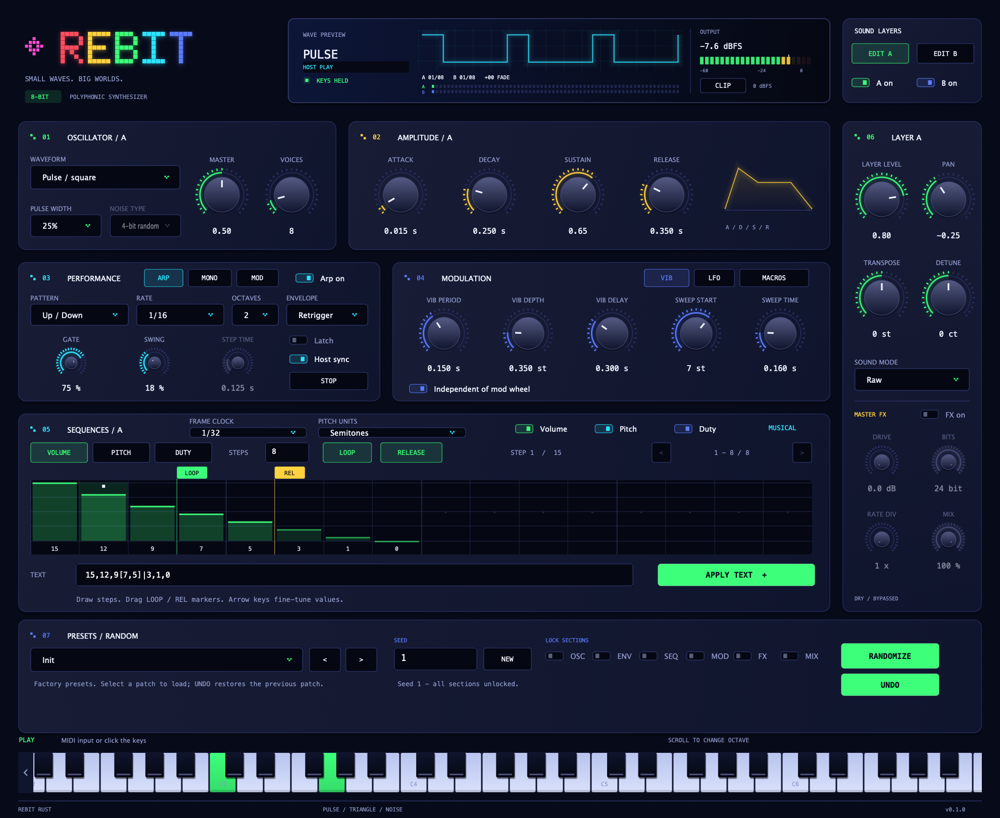
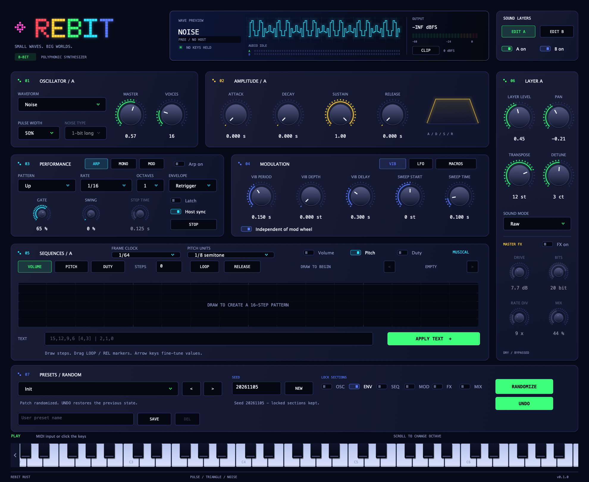

# Rebit Rust

### Small waves. Big worlds.

**An open-source chiptune synth for punchy basses, bright arcade leads, and playful sound effects.**

Bring the character of pulse, triangle, and noise into your next track. Stack two
sound layers, draw patterns that bring each note to life, and go from a simple
bleep to a moving, expressive patch.

**macOS · AU / VST3 / Standalone · Apple Silicon & Intel builds · AGPL-3.0-or-later**

[**Get started →**](#get-started) · [Explore the controls](MANUAL.md) · [Report an issue](https://github.com/romulloqueiroz/rebit/issues)



## Give your next track a little pixel magic

- **Build a bigger chip sound.** Add a low triangle under a pulse bass, or detune
  and pan two layers for a wider lead. Each layer has its own envelope and patterns.
- **Draw the movement.** Shape volume, pitch, and pulse width in the visual
  sequencer. Make a tiny melody, a rhythmic pulse, or a falling laser effect.
- **Turn chords into motion.** Explore five arpeggiator patterns with swing,
  latch, and up to four octaves. Sync to your DAW or play freely.
- **Choose your kind of grit.** Keep the sharp edges in Raw mode, soften them
  with Clean, or add drive, bit crushing, and sample-rate reduction.
- **Play with expression.** Bring patches to life with two LFOs, four macros,
  a modulation matrix, and MPE support for per-note bends, pressure, and timbre.

## Find a sound. Make it yours.

Start with one of 12 factory patches, from **Sub Pulse** and **Arcade Lead** to
**Noise Hat**, **Coin**, and **Power Up**. Tweak a few controls and save your own
version for the next session.

Want a surprise? Lock the parts you like and hit **RANDOMIZE** to explore the
rest. Keep your envelope while changing the tone, or keep the oscillators and
try a new pattern. **UNDO** brings back the previous patch, so you can keep
exploring.



## Get started

The current setup builds from source on **macOS**. You can build for your own
Mac or create a universal build for **Apple Silicon and Intel**.

### 1. Build and open

You'll need Rust/Cargo, CMake 3.22+, Xcode command-line tools, and the pinned
JUCE submodule. Clone with submodules, or initialize them in an existing
checkout:

```sh
git clone --recurse-submodules https://github.com/romulloqueiroz/rebit.git
# or: git submodule update --init --recursive
```

The [build guide](MANUAL.md#build) covers universal builds. Then:

```sh
./scripts/build.sh
open "build/RebitRust_artefacts/Release/Standalone/Rebit Rust.app"
```

In the standalone app, select your MIDI input from **Options**, or click the
on-screen keyboard to try a sound.

### 2. Bring it into your DAW

The build also creates AU and VST3 instruments. Copy the bundle for your format
to its plugin folder, then rescan plugins or restart your DAW:

| Format | Bundle in `build/RebitRust_artefacts/Release/` | Copy to |
| --- | --- | --- |
| AU | `AU/Rebit Rust.component` | `~/Library/Audio/Plug-Ins/Components/` |
| VST3 | `VST3/Rebit Rust.vst3` | `~/Library/Audio/Plug-Ins/VST3/` |

Load **Rebit Rust** on a MIDI instrument track and choose a factory preset.
Current builds are locally ad-hoc signed and are not notarized.

### 3. Try your first patch

1. Choose **Arcade Lead** in **PRESETS / RANDOM** and play a few notes.
2. Try **Wide Layers**, then use **EDIT A / EDIT B** to explore each sound layer.
3. For a rhythmic idea, turn **Arp on**, hold a chord, and change the pattern.
   With **Host sync** on, start your DAW's transport to hear the arp; turn it
   off to audition while stopped.
4. Type a name in **USER PRESET NAME** and press **SAVE** to keep your sound.

## Keep exploring

The [manual](MANUAL.md) covers the controls, sequences, modulation, presets,
and build options. For development details, see the [roadmap](ROADMAP.md) and
[validation notes](VALIDATION.md).

Rebit Rust is an independent instrument with its own plugin identity. It can
coexist with the earlier Rebit, but does not import original Rebit or
Magical8bitPlug2 presets or DAW states. It is not an official YMCK update.

Open source under [AGPL-3.0-or-later](LICENSE). See
[third-party notices](THIRD-PARTY.md) for credits and dependencies.
